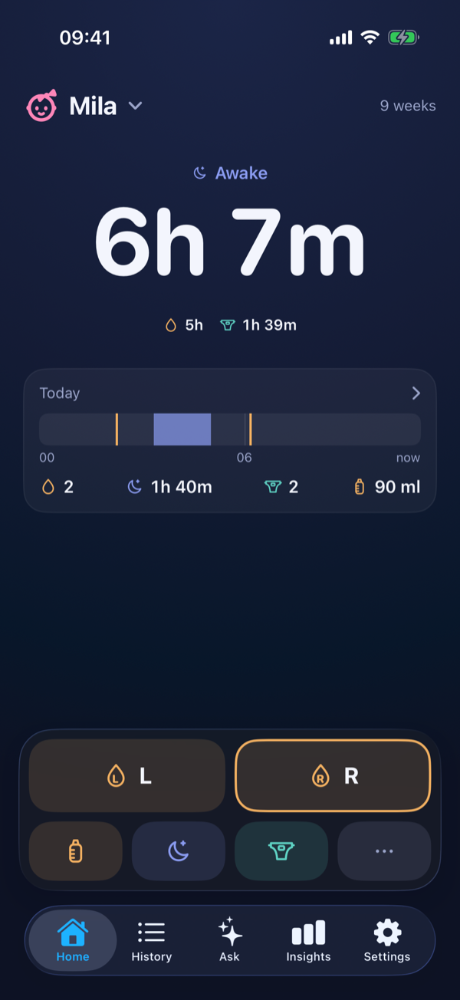
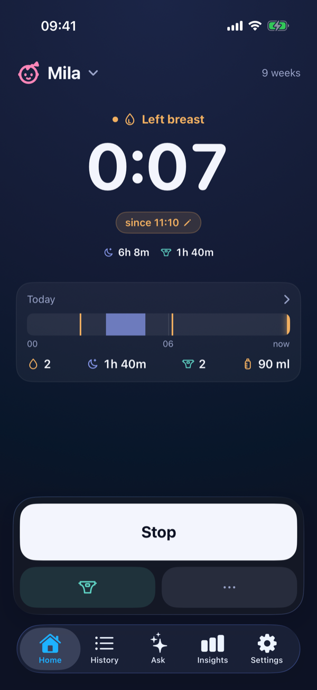
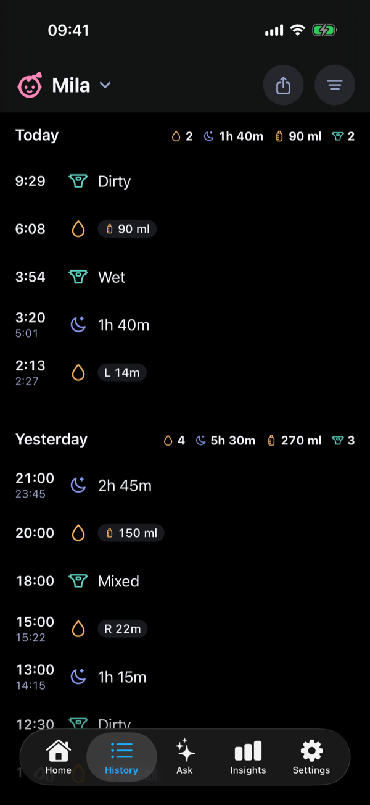
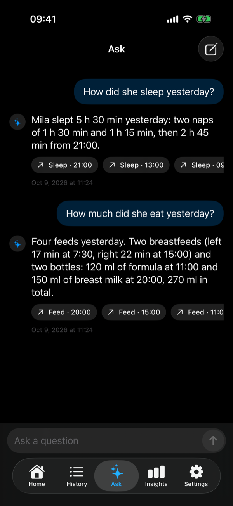
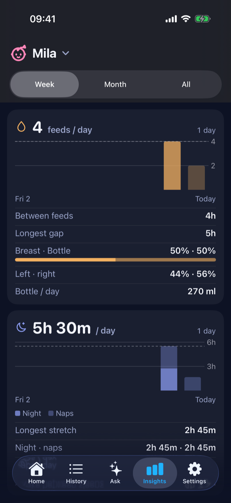

# Baby Tracker

A native iPhone app for logging a newborn's day with one hand, half asleep. Tap
**L** or **R** to time a breastfeed, or log a bottle, a sleep or a diaper in a
couple of taps. Home answers the questions you have at 3 a.m.: how long has she
been awake, and when did she last eat?

<p align="center">
  
  
  
  
  
</p>

## What it does

- **Logs** breastfeeds (left/right timers with breaks), bottles (breast milk,
  formula or mixed), sleep, diapers, solids, medications and growth.
- **History** lists every entry by day with totals. Any entry can be edited or
  backdated.
- **Several babies**, each with their own avatar icon.
- **Insights** charts feeds and sleep per day over a week, a month or all
  time: gaps between feeds, breast/bottle and left/right split, night sleep
  against naps. Growth is charted against the Swiss PEZZ 2025 reference.
- **Ask** answers questions about the log in plain language, using Apple's
  on-device model. Nothing leaves the phone.
- **Lock Screen and Home Screen**: widgets, a Live Activity for running timers,
  and Siri / App Intents for logging without opening the app.
- **Caregivers** can share one baby's log through a self-hosted sync server
  (`Server/`). Without one, everything stays local.
- **Export** writes a full JSON backup through the share sheet.
- English and Ukrainian.

Requires iOS 26.

## Repository layout

```
Apps/BabyTrackerApp/       the app target (thin; wiring only)
Apps/BabyTrackerWidgets/   widgets and the Live Activity
Apps/SharedIntents/        App Intents shared by the app and the widgets
Packages/BabyTracker/      all real logic, as a Swift package with its own tests
UITests/                   XCUITest suite
Server/                    Go sync server (Postgres, Docker Compose)
docs/                      specs, runbooks and verification notes
```

## Build and test

```sh
make build        # build the app for the iPhone 17 Pro simulator
make test         # package tests (asserts the expected test count)
make test-ui      # UI tests
make server-test  # server tests; needs Go and Docker
```

See [`HANDOFF.md`](HANDOFF.md) for project status and
[`Server/README.md`](Server/README.md) for running the sync server.

_Screenshots are from the iOS simulator with demo data. The Ask answers are
mockups written for the demo log, not live model output._
